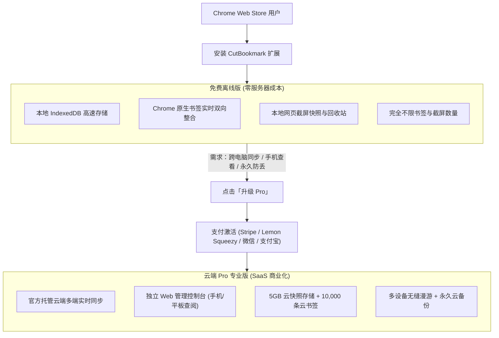
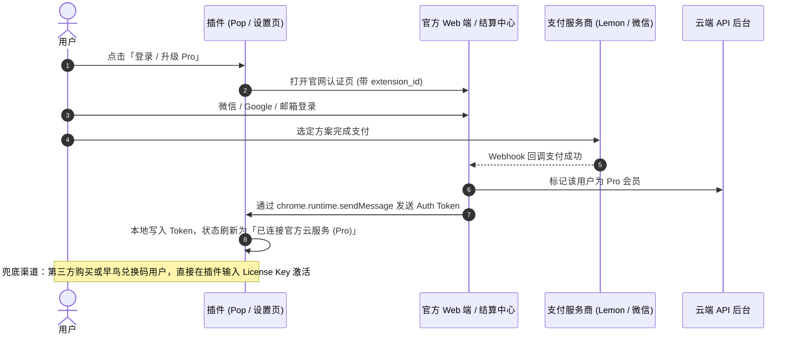
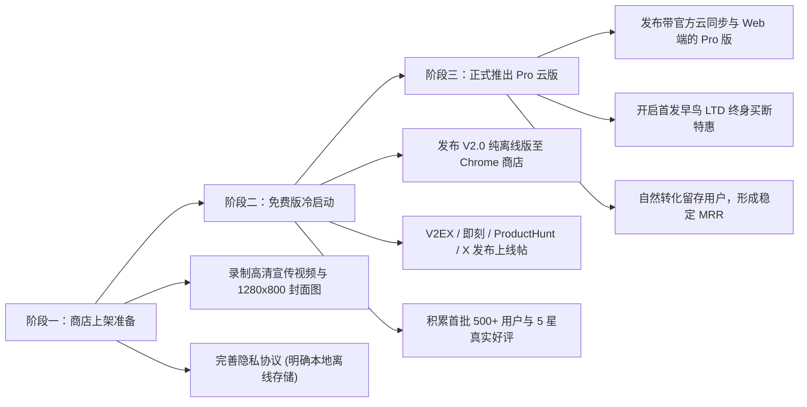

# CutBookmark（截屏书签）Chrome 商店上架与商业化付费方案

> 本方案针对 **Chrome Web Store 上架与独立开发者商业化变现** 设计，采用 **单一插件 Freemium 模式**。离线版依托本地 IndexedDB 与原生书签实现零运维成本获客，云端 Pro 版通过官方托管 SaaS 订阅与早鸟买断实现商业闭环。

---

## 1. 核心产品定位与商业模式



---

## 2. 功能权益与分级矩阵（Feature Gate）

| 功能模块 | 免费离线版 (Free Offline) | 云端 Pro 专业版 (Pro Cloud) | 说明与设计意图 |
| :--- | :--- | :--- | :--- |
| **存储架构** | 用户浏览器本地 IndexedDB | 官方云端集群 + 本地多端同步 | 免费版不消耗任何服务器成本，安全隐私 |
| **书签与截图数量** | **完全不限量 (Unlimited)** | **10,000 条云端书签** | 免费版不设卡以赢得 5 星好评与口碑传播 |
| **快照云存储空间** | 仅保存在本地设备硬盘 | **5GB 高速云存储** (自动 WebP 压缩) | 相当于约 1.5 万~ 2 万张网页高清快照 |
| **设备支持与漫游** | 单一浏览器本地使用 | **多设备实时漫游** (Mac/Windows/公司/家) | 知识工作者的核心刚需付费痛点 |
| **跨端 Web 查看** | 不支持 | **官方独立 Web 端** (支持手机/平板访问) | 随时随地查阅收藏内容与网页截屏 |
| **原生书签整合** | 完整支持 (Chrome 书签树) | 完整支持 (双向实时映射) | 保留核心原生能力 |
| **回收站保留期** | 7 天自动清理 | **30 天防误删保留** | 提供额外数据安全兜底 |
| **技术支持与更新** | 社区/Issue 反馈 | **优先客服通道 + 专属功能投票权** | 增强付费用户归属感 |

---

## 3. 定价梯度与收费通道（双币种与早鸟策略）

为了最大化兼顾全球出海市场与国内独立开发者支持者，采用双轨通道：

### 3.1 价格阶梯体系

```
┌─────────────────┬───────────────────┬───────────────────┬──────────────────┐
│ 付费方案        │ 海外美金定价       │ 国内人民币定价     │ 策略定位         │
├─────────────────┼───────────────────┼───────────────────┼──────────────────┤
│ 月度订阅 (Monthly)│ $2.99 / 月        │ ¥9.9 / 月         │ 低门槛体验尝鲜    │
├─────────────────┼───────────────────┼───────────────────┼──────────────────┤
│ 年度订阅 (Yearly) │ $24.00 / 年 (33% off)│ ¥69.00 / 年 (42% off)│ 主力推荐方案 (高 LTV)│
├─────────────────┼───────────────────┼───────────────────┼──────────────────┤
│ 首发早鸟终身买断(LTD)│ $49.00 (限量 200 席) │ ¥129.00 (限量 300 席)│ 快速回笼启动资金与忠实粉丝│
└─────────────────┴───────────────────┴───────────────────┴──────────────────┘
```

> **关于终身买断（Lifetime Deal）的成本风控**：
> 终身卡附带同样的 **5GB 云快照存储上限**。由于云存储按容量锁死，单用户终身存储成本上限约 $1.2（按 Cloudflare R2 测算），收取 $49 / ¥129 可确保健康毛利，杜绝被羊毛党刷爆成本。

### 3.2 支付与收单通道
- **海外市场**：首选 **Lemon Squeezy** 或 **Stripe Checkout**（自动处理全球各地区消费税与合规发票，支持信用卡、Apple Pay、Google Pay）。
- **国内市场**：推荐接入 **微信支付商户 / 支付宝当面付**（或轻量方案如 **面包多 / 爱发电 / 易支付**）。

---

## 4. 技术认证与激活架构流程



---

## 5. 云存储与服务器成本精算（Unit Economics）

按 **1,000 名付费 Pro 用户** 模型推演：

| 成本项 | 服务选型推荐 | 单价基准 | 1000 付费用户月度开销 |
| :--- | :--- | :--- | :--- |
| **快照对象存储** | **Cloudflare R2** (零出网流量费) | 存储 $0.015/GB/月 | 假设均用满 2GB：2,000 GB ≈ **$30 / 月** |
| **API 与数据库** | **Supabase / Fly.io / 腾讯云轻量** | 基础规格容器 + PG | 约 **$25 ~ $40 / 月** |
| **图片压缩** | 浏览器端 Offscreen Canvas 压缩 WebP | 客户端算力 (0成本) | **$0** |
| **总服务器开销** | — | — | **约 $55 ~ $70 / 月 (¥400 ~ ¥500)** |
| **预期月度营收** | 按 70% 年付 + 30% 月付折算 | 每用户月均 $2.0 | **约 $2,000 / 月 (¥14,000+)** |
| **毛利率** | — | — | **> 96%** |

---

## 6. 上架与推广落地路线图



> **冷启动核心秘诀**：
> 第一阶段**千万不要一上来就加限制拦截**。先以「完全免费、无广告、纯离线、界面优雅」为核心卖点，在 Chrome 商店迅速拿下第一批安装量和正面评价。当用户依赖你的书签管理与截屏功能、并开始频繁产生“在公司电脑也想看家里的书签”诉求时，云端 Pro 的转化率将极为自然且高效。
